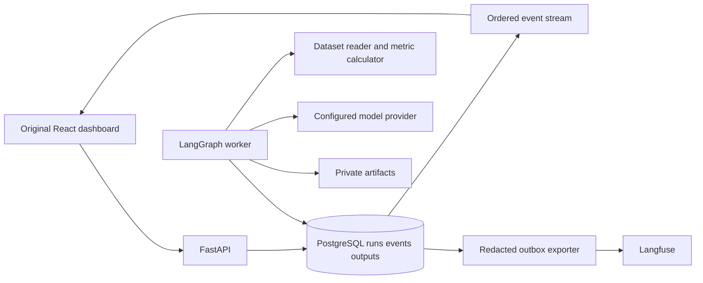

# Genesis detailed implementation plan

## 1 Product decision

Build a multiagent operations observatory for data teams. Its first mission is **evidence-backed analysis of LLM execution cost and quality**, derived from Annex A1 of the brief. An operator submits a question against a public or synthetic execution dataset; four agents coordinate research, analysis, and verification, producing a cited recommendation. The original observatory shows both the process and every agent's usable output.

The product decision is provisional for classroom topic approval, which has not been obtained. Planning and technical prototyping do not depend on that approval. Validate the business hypothesis through three data-team interviews before describing commercial demand as established. Ask what failure they last investigated, how long it took, what decision evidence was missing, and whether this workflow changes that decision. Record evidence rather than invented market scores or revenue estimates.

[Commercial discovery](DISCOVERY.md) assigns Annex B's eight questions and exact weighted topic matrix to W00. Document hypotheses and lawful fixture provenance before implementation; retain unknown scores until supported. The product can remain an explicitly educational prototype while commercial validation is pending.

Primary user: a data/AI operations lead investigating an expensive, slow, or unreliable run. Primary task: move from an anomalous metric to the responsible attempt, its evidence, its output, and a defensible corrective action. Secondary user: an evaluator comparing routing policies. The classroom assessor must be able to reproduce all required charts and conclusions locally.

## 2 Boundaries

MVP includes four functioning agents, two read-only tools, durable structured traces, six required visualizations, linked filters, run comparison, replay, output inspection, a minimum of 20 real executions across five scenarios, report, and demonstration. The first usable slice contains the entire path, even if only one scenario and one screen are present.

Defer multi-tenant SaaS, billing, arbitrary remote code execution, multi-cloud provisioning, marketplace plugins inside the product, autonomous production changes, Kubernetes, and a bespoke orchestration framework. No open-ended agent loops. Do not add a fifth writer unless experiments justify the extra latency and expense. Add a scale backend only after measured bottlenecks.

No fabricated live numbers. Fixtures are labeled fixtures. Provider usage can be missing; display unavailable. Estimated prices are not invoices. A verified result is not guaranteed truth. A successful transport request does not establish a successful mission.

## 3 Selected architecture

Use the brief's advanced path: **Python LangGraph + Langfuse integration + React Flow + Apache ECharts**. React/TypeScript with Vite hosts the custom UI; FastAPI exposes typed read/query and mission endpoints; PostgreSQL stores authoritative application events, outputs, and experiment metadata. Use SQLAlchemy/Alembic for explicit migrations if the implementation spike confirms the integration; use Python decimal arithmetic for money.

Run the graph in a dedicated worker process with durable LangGraph checkpoints. Keep a single worker and bounded concurrency initially. Persist run requests before acknowledging them; implement transactional claims, a lease/heartbeat, attempt fencing and recovery tests before allowing multiworker execution. Do not treat an HTTP request's in-memory background task as a durable job runner. Evaluate a maintained durable queue only if the PostgreSQL worker exceeds the tested recovery requirements.

Application event storage is the replay and dashboard source of truth. Langfuse is the secondary trace/evaluation inspection system required by the chosen architecture; the application remains usable during exporter failure. Export sanitized telemetry asynchronously through a persistent outbox. Pin a compatible SDK/exporter and semantic-convention revision in W01. The OpenTelemetry GenAI conventions are evolving; do not allow upstream naming changes to silently mutate the product contract.

Start with local PostgreSQL plus a local artifact directory outside the public web root. A private object store is a later interchangeable artifact backend when deployed. Store only metadata and bounded summaries inline. Langfuse cloud is appropriate only for explicitly permitted public/synthetic data and configured credentials; full self-hosting has additional infrastructure, so keep it an optional development profile with a verified resource budget. Check current upstream deployment instructions rather than copying legacy v2 examples.

Separate mission data from observatory telemetry. If the analyst studies an input execution dataset, attach its immutable dataset ID; do not accidentally analyze the current run's incomplete traces as the business dataset. Provider calls, tool calls, handoffs, validation decisions and artifact versions must remain individually inspectable.

## 4 Runtime agent responsibilities

| Agent | Input and tools | Required output | Interaction and completion |
|---|---|---|---|
| Coordinator | Mission, allowed dataset manifest, budget policy | Structured task plan with IDs, constraints and assignments | Assign researcher; hand evidence to analyst; route verifier verdict; finalize only an accepted result |
| Researcher | Assigned question; allowlisted dataset/document reader | Evidence bundle with source IDs, retrieval time, row/document references and missing-data notes | Send bundle to analyst; accept one bounded clarification request |
| Analyst | Evidence bundle; deterministic metric calculator | Findings with exact calculation IDs, units, limitations, recommended policy | Send draft and evidence to verifier; revise if a specific correctable defect is returned |
| Verifier | Original mission, evidence, draft, independent recalculation tool | Structured accept/revise/reject verdict with criterion results and evidence links | Return verdict to coordinator and analyst; one repair cycle maximum |

Every role has versioned instructions, an explicit goal, schema, tool allowlist, maximum calls and output length. The reader and calculator are genuinely distinct tools with recorded invocations. The calculator accepts a typed operation vocabulary, never generated Python or shell code. The verifier uses an independent prompt and execution context, not the author's self-attestation.

Default proposed limits for the spike: maximum 12 model calls per run, 20 total tool calls, one analyst revision, two retries of a retryable provider/tool request, five-minute wall timeout, and concurrency two. These are starting engineering limits to tune from measured traces. Dollar caps require a configured pricing table and explicit run budget; if either is missing, live execution stays disabled while fixture replay remains available.

## 5 Ordered milestones

| Milestone | Outputs | Exit evidence | Dependency |
|---|---|---|---|
| M0 Requirements and design | This package, source mapping, skill provenance, screen specification | Independent planning review; unresolved items classified | None |
| M1 Contract and walking slice | Locked dependencies; schema; migration; four-agent run; two tools; stored events; simple output UI | One reproducible live run with complete trace and clean schema roundtrip | M0 |
| M2 Reliable execution | Checkpoints, cancellation, bounded retries, idempotency, artifact lineage, exporter | Crash/resume, duplicate and disconnect tests; no double-counted costs | M1 |
| M3 Visual observatory | Six charts, filters, output drawer, comparison, replay, URL state | Required user journeys, visual and keyboard review with realistic fixtures | M1; live reliability relies on M2 |
| M4 Experiments and interpretation | 20-run minimum; stronger 50-run target; policy comparison; evidence-backed findings | Reproducible analysis, evaluator calibration, uncertainty and missingness disclosed | M2 + M3 |
| M5 Delivery | Install guide, report, 10–12 minute demo, tested local profile, optional hosted preview | Clean-machine rehearsal; independent release review; source-to-evidence matrix complete | M4 |

Planning estimate: 18–25 focused person-days for M1–M5, with a 25% contingency for provider integration and visual QA. This is a capacity assumption, not a delivery promise. Two contributors may overlap contract-conforming frontend and backend work after M1 contracts are stable. Do not parallelize shared schema ownership. Prioritize the rubric's 65 points for visualization, interaction and interpretation without sacrificing trace integrity.

## 6 Delivery structure

Proposed implementation folders, not yet created: `apps/web`, `services/api`, `services/worker`, `packages/contracts`, `agents/prompts`, `experiments`, `tests/fixtures`, `tests/e2e`, `infra`, `docs/reviews`. Prefer one Python package shared by API/worker over duplicate business logic. Generate TS contract types from the versioned API schema, not a second handwritten interpretation. Select exact dependency versions during M1 and commit lockfiles; avoid invented future pins in this plan.

## 7 Decisions required by implementation

W01 must record provider availability and account limits, actual model IDs, pricing snapshots, dependency compatibility, license review and the local runtime baseline. These can be investigated without user interruption. The only externally supplied blockers are credentials/budget for live runs, a GitHub destination for publishing, and classroom topic approval before claiming an approved academic subject. UI prototypes and deterministic tests proceed without those values.

## 8 Release definition

The product is releasable when every mandatory source requirement has evidence, all blocking review findings are resolved, the dashboard's numbers reconcile with trace records, all six views support their intended questions, and a new environment can replay fixtures without credentials. Live-run evidence remains separately labeled. Quality is established through these gates, never through an assertion that the project is perfect.
