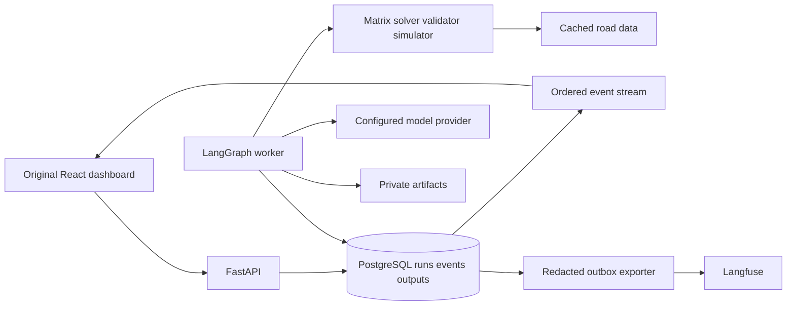

# Genesis detailed implementation plan

## 1 Product decision

Build **Genesis Logistics Observatory**, selected from Annex A11 by the user. A dispatcher compares delivery plans, inspects delays/capacity/cost, simulates disruptions and understands the five agents' outputs. The route map and verified visit plan are the primary business views; the original multiagent observatory exposes the workflow, tool evidence, reliability, tokens and separate AI spend.

The user has selected A11; teacher approval and commercial demand remain unverified. Validate the hypothesis through three dispatcher/fleet-operator interviews covering a recent planning problem, actual constraints, baseline process and purchase decision. Record evidence rather than invented market scores, revenue or savings. "Very high potential" in the brief is an idea rating, not validated demand. A useful product must improve dispatch decisions against an existing planner with comparable service coverage.

[Commercial discovery](DISCOVERY.md) assigns Annex B's eight questions and exact weighted topic matrix to W00. Document hypotheses and lawful fixture provenance before implementation; retain unknown scores until supported. The product can remain an explicitly educational prototype while commercial validation is pending.

Primary user: dispatcher for a local delivery/distribution fleet. Primary task: identify an infeasible or delayed route, inspect the affected stops and constraint evidence, compare a bounded replan and understand its tradeoffs. Secondary user: AI/data lead diagnosing the agent execution. [LOGISTICS-SPEC.md](LOGISTICS-SPEC.md) defines routes, simulation, solver boundaries, costs and acceptance. The classroom assessor can reproduce all required charts and conclusions locally.

## 2 Boundaries

MVP: one depot, 3–5 identical vans, 25–50 synthetic stops, outbound deliveries, parcel capacity, service-start windows, shift return and one bounded replan. Five functioning agents use typed matrix, optimization, validation and simulation tools. Include durable traces, six required observatory visualizations **plus route map**, linked filters, plan/run comparison, dual-clock replay, output inspection, at least 20 actual agent executions across five logistics scenarios, report and demonstration. First slice covers the full path on one scenario.

Defer multi-depot, pickups/returns, live GPS/traffic, driver-hours compliance, electric charging, actual dispatch, SaaS billing, Kubernetes and unrestricted execution. No open-ended agent loops. Route feasibility comes from deterministic tools; models supply coordination and explanations. Detailed exclusion and cargo/replanning rules are in LOGISTICS-SPEC.md.

No fabricated live numbers. Fixtures are labeled fixtures. Provider usage can be missing; display unavailable. Estimated prices are not invoices. A verified result is not guaranteed truth. A successful transport request does not establish a successful mission.

## 3 Selected architecture

Use the brief's advanced path: **Python LangGraph + Langfuse integration + React Flow + Apache ECharts**. React/TypeScript with Vite hosts the custom UI; FastAPI exposes typed read/query and mission endpoints; PostgreSQL stores authoritative application events, outputs, and experiment metadata. Use SQLAlchemy/Alembic for explicit migrations if the implementation spike confirms the integration; use Python decimal arithmetic for money.

Add **OR-Tools** for bounded CVRPTW search, **OSRM adapter** for cached directional road matrices/geometries and **MapLibre GL JS** for the map. W01 verifies local setup, data permissions, solver compatibility and offline fixtures. Record road sources, versions and traffic-simulation assumptions. Route optimization, AI model routing and telemetry are separate responsibilities; see [logistics research](research/logistics-research.md).

Run the graph in a dedicated worker process with durable LangGraph checkpoints. Keep a single worker and bounded concurrency initially. Persist run requests before acknowledging them; implement transactional claims, a lease/heartbeat, attempt fencing and recovery tests before allowing multiworker execution. Do not treat an HTTP request's in-memory background task as a durable job runner. Evaluate a maintained durable queue only if the PostgreSQL worker exceeds the tested recovery requirements.

Application event storage is the replay and dashboard source of truth. Langfuse is the secondary trace/evaluation inspection system required by the chosen architecture; the application remains usable during exporter failure. Export sanitized telemetry asynchronously through a persistent outbox. Pin a compatible SDK/exporter and semantic-convention revision in W01. The OpenTelemetry GenAI conventions are evolving; do not allow upstream naming changes to silently mutate the product contract.

Start with local PostgreSQL plus a local artifact directory outside the public web root. A private object store is a later interchangeable artifact backend when deployed. Store only metadata and bounded summaries inline. Langfuse cloud is appropriate only for explicitly permitted public/synthetic data and configured credentials; full self-hosting has additional infrastructure, so keep it an optional development profile with a verified resource budget. Check current upstream deployment instructions rather than copying legacy v2 examples.

Separate fleet business data from observatory telemetry. Immutable depot/fleet/stop inputs, route versions, road matrices and simulation events are linked artifacts. Actual model execution timestamps and simulated delivery times use separate clocks. Never mix estimated fleet operating cost with API spend or optimization penalties. Preserve every tool call, handoff, certificate and route artifact version.

## 4 Runtime agent responsibilities

| Agent | Input and tools | Required output | Interaction and completion |
|---|---|---|---|
| Planning | Mission, depot/stops/fleet and constraints | Versioned work order and assignments | Coordinator; finalize verified plan or diagnostic |
| Simulated traffic | Frozen road matrix and permitted forecast descriptor | Static forecast and revealed-event refs; sealed evaluation schedule stays simulator-only | Researcher; send permitted evidence to optimization/monitoring |
| Optimization | Work order and matrices; baseline/OR-Tools tool | Candidate, baseline, objective components and search status | Analyst; send routes to monitoring |
| Monitoring | Routes and source inputs; independent validator/simulator | Feasibility certificate, simulated fleet KPIs and issues | Verifier; send verdict to planning and exception |
| Exception | Monitoring report and bounded policy | No-action or one permitted residual replan request | Send to planning/optimization; preserve completed work and cargo constraints |

Every role has versioned instructions, objective, schema and tool allowlist. Course coordinator/researcher/analyst/verifier responsibilities map to the first four roles; exception is the meaningful fifth role proposed in A11. Monitoring recomputes constraints independently of solver totals. A model cannot approve a certificate with overload, duplicate stops or broken time windows. Typed tools expose no generated Python, arbitrary SQL or shell.

Simulation retains private future events. Agents receive only forecasts/current revealed events. Initial full-plan and residual-suffix certificates have different scope; a recovered future route cannot erase prior realized lateness or missing mandatory cargo. Paired policies share initial data/exogenous schedules while their positions and reaction times evolve independently under the same safe-boundary rule.

Initial proposed limits: 15 model calls, 24 tool calls, one replan, two transient-request retries, five-minute run wall timeout, 20 seconds per solver search and concurrency two. Tune from measured traces. Dollar caps require pricing and explicit run budget; if either is missing, live model execution remains disabled. Solver-only/offline fixture work proceeds. Atomic reservations remain mandatory for concurrent billable calls.

## 5 Ordered milestones

| Milestone | Outputs | Exit evidence | Dependency |
|---|---|---|---|
| M0 Requirements and design | This package, source mapping, skill provenance, screen specification | Independent planning review; unresolved items classified | None |
| M1 Contract and walking slice | Locked dependencies; domain/event schemas; tiny solver/validator fixture; five-agent run; stored events; route/output UI | Independently valid small route, one actual agent run and schema roundtrip | M0 |
| M2 Reliable execution | Checkpoints, cancellation, bounded retries, idempotency, artifact lineage, exporter | Crash/resume, duplicate and disconnect tests; no double-counted costs | M1 |
| M3 Visual observatory | Map, six charts, fleet/AI metrics, output drawer, comparison, dual-clock replay, URL state | Route/certificate linkage, accessible table alternative and visual review | M1; live reliability relies on M2 |
| M4 Experiments and interpretation | 20 minimum/50 target, baseline vs solver/replan under paired logistics scenarios | Same exogenous events, coverage/feasibility reported, no simulated-to-real savings claims | M2 + M3 |
| M5 Delivery | Install guide, report, 10–12 minute demo, tested local profile, optional hosted preview | Clean-machine rehearsal; independent release review; source-to-evidence matrix complete | M4 |

Revised planning estimate: 25–35 focused person-days for M1–M5, plus 25% contingency for solver/maps/replanning integration and visual QA. This capacity assumption needs W01 calibration. Protect the single-depot scope for a two-person course project. Frontend/backend may overlap only after contracts are stable. Prioritize the rubric's 65 points for visualization, interaction and interpretation while preserving trustworthy route data.

## 6 Delivery structure

Proposed implementation folders, not yet created: `apps/web`, `services/api`, `services/worker`, `packages/contracts`, `agents/prompts`, `experiments`, `tests/fixtures`, `tests/e2e`, `infra`, `docs/reviews`. Prefer one Python package shared by API/worker over duplicate business logic. Generate TS contract types from the versioned API schema, not a second handwritten interpretation. Select exact dependency versions during M1 and commit lockfiles; avoid invented future pins in this plan.

## 7 Decisions required by implementation

W01 must record provider availability and account limits, actual model IDs, pricing snapshots, dependency compatibility, license review and the local runtime baseline. These can be investigated without user interruption. Remaining external inputs are credentials/budget for live runs and classroom topic approval before claiming an approved academic subject. GitHub destination is resolved as `GirardRaphael/Genesis`; `origin` is configured and the reviewed planning branch is published. UI prototypes and deterministic tests proceed without live-model credentials.

## 8 Release definition

The product is releasable when every mandatory source requirement has evidence, all blocking review findings are resolved, the dashboard's numbers reconcile with trace records, all six views support their intended questions, and a new environment can replay fixtures without credentials. Live-run evidence remains separately labeled. Quality is established through these gates, never through an assertion that the project is perfect.

## Accepted execution extensions — 2026-10-10

User authorized implementation and then added Anthropic-only execution, live agent/model/individual/overall metering, Power BI-style analytics, and an address-based Montréal delivery workflow. Google Maps was replaced with a keyless stack at the user's direction. IMPLEMENTATION-STATUS tracks achieved evidence; DISPATCH.md specifies the new local operator workflow and company release gates. Original synthetic benchmarks remain separate from operator-entered trips, municipal worksite permits and simulated positions. No external-provider fallback may silently change costs, physical constraints or provenance.

U10 adds automatic broker consolidation/split allocation and U11 adds the candid engineering/business audit. The implemented scope and current blockers are in DISPATCH.md and TRANSPORT-CHECKLIST.md; independent admission findings and their verified corrections are in reviews/broker-review.md. Commercial launch remains blocked by the listed P0 gates.

U12 adds entered-address previews, editable multi-delivery drafts and recurring-route memory. ROUTE-MEMORY.md defines comparable successful history, bounded aggregate model context, current-road revalidation and the explicit routine explanation policy. History is an input to present validation, never permission to copy old certificates or a claim of measured driver performance. Dedicated browser tests use an isolated database instead of operator vans.

U13 adds optional shared-budget email notifications. The persistent ledger remains authoritative; transactional alert capture and an independent SMTP worker preserve budgeting when delivery fails. BUDGET-EMAIL.md defines triggers, private setup, truthful acceptance/uncertainty status and the explicit lack of a resend/reset operation. No external account, destination or mail delivery is presumed.
